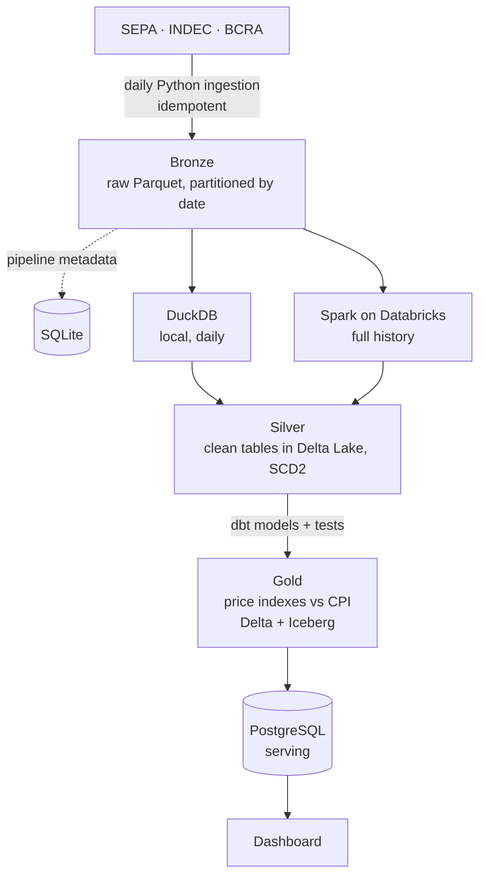

# gondola-lakehouse

Lakehouse of Argentine supermarket prices built on open data, to answer one question:

> **Does supermarket shelf inflation, in Mendoza and nationwide, match the official CPI (INDEC)?**

> **Status:** work in progress. Phase 1 (ingestion to bronze) is under way; see the [roadmap](#roadmap).

## Data sources

| Source | What it provides | Volume |
|---|---|---|
| **SEPA** (Precios Claros), via the CKAN API of datos.produccion.gob.ar | Daily prices from every large retailer: stores, branches and products | ~14 M rows per day |
| **INDEC CPI** | Official monthly inflation by region and category | Small |
| **BCRA** | Exchange rate and other macro variables | Small |

SEPA only keeps the last 7 days online, so the pipeline has to ingest every day to build history.

## Architecture

Medallion architecture (bronze → silver → gold) on open table formats. The same transformations run on two engines:
**DuckDB** locally for daily development and **Spark on Databricks** for the full history.



| Layer | Content |
|---|---|
| **Bronze** | SEPA files as published, in Parquet, partitioned by date; ingestion metadata (files, watermarks, row counts) in SQLite |
| **Silver** | Typed, deduplicated prices; product and branch history (SCD type 2) |
| **Gold** | Price indexes by region and category compared with the CPI, published to PostgreSQL |

## Stack

| Area | Tools |
|---|---|
| Language | Python 3.11+, SQL |
| Processing | DuckDB, Apache Spark / PySpark on Databricks |
| Storage | Parquet, Delta Lake, Apache Iceberg |
| Transformation and quality | dbt (dbt-duckdb and dbt-databricks), dbt tests |
| Serving | PostgreSQL |
| Cloud and infrastructure | Azure (ADLS Gen2, Key Vault), Terraform |
| Orchestration and CI | Apache Airflow, GitHub Actions |
| Tooling | uv, pytest, ruff |

## Roadmap

- [ ] **Phase 1 · Ingestion to bronze:** daily SEPA ingestion, idempotent and partitioned, with pipeline metadata and tests.
- [ ] **Phase 2 · Silver, gold and serving:** dbt models on DuckDB, SCD2, data quality tests, price indexes, PostgreSQL and dashboard.
- [ ] **Phase 3 · Cloud:** the same pipeline on Databricks with Spark over ADLS Gen2, provisioned with Terraform; DuckDB vs Spark comparison.
- [ ] **Phase 4 · Orchestration:** Airflow DAG with retries and alerts, CI on every pull request, gold exported to Iceberg.

Each phase starts with an architecture decision record (ADR) and is delivered through a reviewed pull request.

## Getting started

```bash
uv sync
uv run pytest
uv run ruff check .
```
